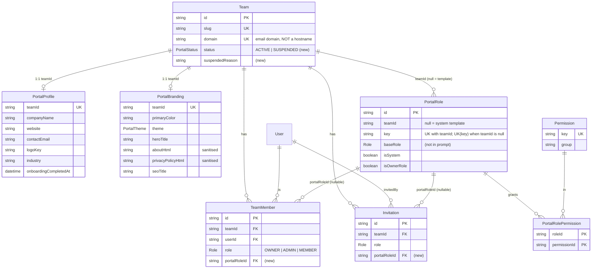

# Entity relationship diagram

Phase 1 models (new and changed). Tenant-owned tables carry `teamId` and are
protected by the Prisma tenant guard (`lib/tenantGuard.ts`).

Notes

- `PortalRole` uniqueness: `UNIQUE(teamId, key)` plus a partial unique index
  `PortalRole_system_key_unique ON (key) WHERE teamId IS NULL` (added in the
  migration) because NULLs are distinct in a plain unique index.
- Deleting a `PortalRole` sets `TeamMember.portalRoleId` / `Invitation.portalRoleId`
  to NULL (the API refuses to delete a role that is still in use).
- Models for jobs, candidates, applications, AI, billing entitlements and so on
  are added by later phases; this file grows with them.
